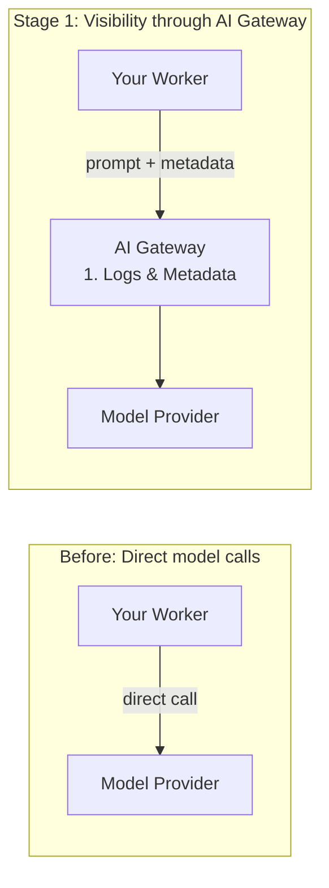

# See every request

<figure>
<video controls playsinline preload="none" width="1920" height="1080" crossorigin="anonymous" poster="/media/courses/ai-gateway/see-every-request-poster.jpg">
<source src="/media/courses/ai-gateway/see-every-request.mp4" type="video/mp4">
<track kind="captions" src="/media/courses/ai-gateway/see-every-request-captions.vtt" srclang="en" label="English">
<a href="/media/courses/ai-gateway/see-every-request.mp4">Watch the demo clip</a>.
</video>
<figcaption>Routing a model request through AI Gateway and inspecting its log and metadata. <a href="/media/courses/ai-gateway/see-every-request.mp4">Direct video link</a></figcaption>
</figure>

Before you can control your AI traffic, you need to see it. Routing calls through [AI Gateway](https://developers.cloudflare.com/ai-gateway/) records the provider, model, input and output tokens, duration, and estimated cost for every request, while server-attached `metadata` (up to five flat key-value pairs like `user` and `team`) lets you filter logs, break down spend, and route traffic even when your whole app shares one gateway credential.

## What you'll build

An AI Gateway in your Cloudflare account and an interactive lab Worker that calls a [Workers AI](https://developers.cloudflare.com/workers-ai/) model through the gateway, tags each request with `user` and `team` metadata, and displays the model's answer alongside `env.AI.aiGatewayLogId` so you can inspect the matching record in your Cloudflare dashboard.

## Prerequisites

Your agent can help you with these.

- [Node.js](https://nodejs.org/) installed.
- A free [Cloudflare account](https://dash.cloudflare.com/sign-up).
- The [`cf` CLI](/courses/agent-setup/cli) logged in to your Cloudflare account (`cf auth whoami`).

## Where AI Gateway sits: before and after

Without a gateway, each part of your application calls model providers directly, leaving you with no single place to see usage or attach team tags. In this first stage, every request passes through AI Gateway so it can log the call and record your `metadata` before forwarding to the model:



In a Worker using the [Workers AI binding](https://developers.cloudflare.com/ai-gateway/usage/worker-binding-methods/), you pass a `gateway` object as the third argument to `env.AI.run()`:

```ts title="src/index.ts"
const result = await env.AI.run(
  "@cf/google/gemma-4-26b-a4b-it", // any affordable Workers AI chat model
  { messages: [{ role: "user", content: prompt }] },
  {
    gateway: {
      id: "dev-school-gateway",
      metadata: { user, team },
    },
  },
);

// Response shape varies by model: { response } or OpenAI-style choices[].
const answer =
  (result as { response?: string }).response ??
  (result as { choices?: Array<{ message?: { content?: string } }> }).choices?.[0]?.message
    ?.content ??
  result;

return Response.json({
  response: answer,
  logId: env.AI.aiGatewayLogId,
  metadata: { user, team },
});
```

If you call OpenAI, Anthropic, or another provider from an SDK, it's the same idea: point `baseURL` at `https://gateway.ai.cloudflare.com/v1/<account-id>/<gateway-id>/<provider>` and pass metadata in the `cf-aig-metadata` header.
