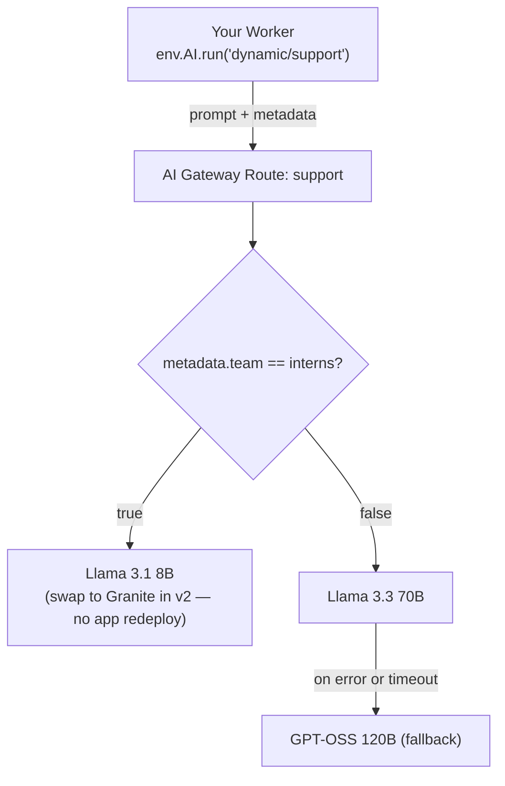

# Route and fall back

<figure>
<video controls playsinline preload="none" width="1920" height="1080" crossorigin="anonymous" poster="/media/courses/ai-gateway/route-and-fall-back-poster.jpg">
<source src="/media/courses/ai-gateway/route-and-fall-back.mp4" type="video/mp4">
<track kind="captions" src="/media/courses/ai-gateway/route-and-fall-back-captions.vtt" srclang="en" label="English">
<a href="/media/courses/ai-gateway/route-and-fall-back.mp4">Watch the demo clip</a>.
</video>
<figcaption>Routing requests by team metadata and swapping models in AI Gateway without redeploying the app. <a href="/media/courses/ai-gateway/route-and-fall-back.mp4">Direct video link</a></figcaption>
</figure>

When a model name is hardcoded in your application, every model upgrade, tier change, or provider outage requires a code change and a deployment across every service that calls it. Moving model choice into a versioned [route](https://developers.cloudflare.com/ai-gateway/features/dynamic-routing/) in AI Gateway lets the gateway pick the model from request metadata, fall back automatically if a primary model fails, and swap or roll back models without touching your application code.

## What you'll build

A gateway route named `dynamic/support` that sends `interns` to a fast economical model and `escalations` to a larger model with an automatic fallback. Then you'll deploy a second version of the route and watch the model change with zero Worker redeploy.

## Prerequisites

- You've completed [Cap requests and spend](/courses/ai-gateway/cap-requests-and-spend) and still have that Worker and gateway.

## Moving model choice into a route

Instead of naming a specific model in code, your Worker calls `"dynamic/support"` and passes who's asking in `metadata`:

```ts title="src/index.ts"
const result = await env.AI.run(
  "dynamic/support",
  { messages: [{ role: "user", content: prompt }] },
  {
    gateway: {
      id: "dev-school-gateway",
      metadata: { user, team },
    },
  },
);
```

Inside AI Gateway, the `support` route evaluates your versioned decision graph: it checks `metadata.team`, routes each team to the right model, falls back to a backup model if the primary model fails or times out, and lets you publish a new version of the route without redeploying your Worker:


