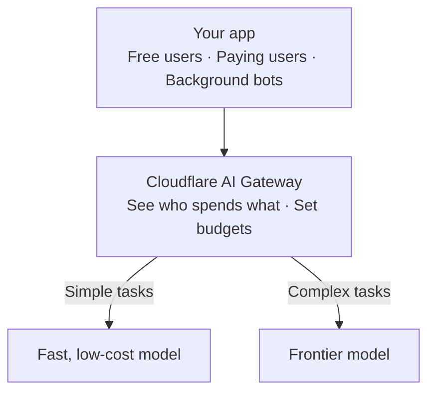

# See and control AI spend

The cost of implementing AI features in your app can add up fast. When every request (whether by human or agent) calls models with the same API key, you're missing valuable information. To optimize the associated costs, you need to know:

- who spent what
- what models were used
- how many tokens were sent

In this course, you'll start from the [three-caller lab](https://github.com/jamesqquick/ai-spend-control-course/tree/main), which sends requests directly to Workers AI. It has presets to make AI calls from:

- free-user
- pro-user
- background-bot

You'll then update the Worker to send those same requests through [AI Gateway](https://developers.cloudflare.com/ai-gateway/) to get insights, logging, and visibility into the details of each call.

