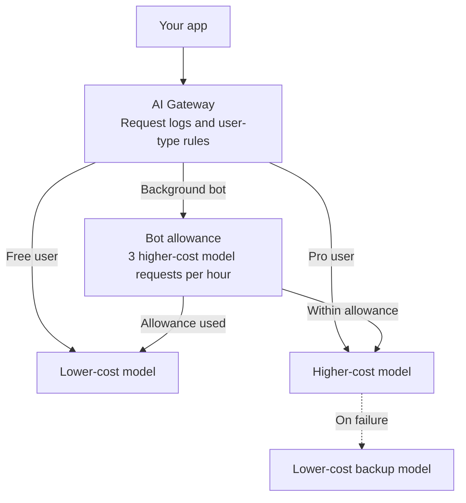

# See and control AI spend

The cost of implementing AI features in your app can add up fast. However, a total usage number doesn't tell you whether requests came from free users, paying customers, or a background bot. To control that usage, you need to know:

- which user types generate requests
- which models handle those requests
- how many tokens each request uses and the associated costs

In this course, you'll start from a [sample application](https://github.com/jamesqquick/ai-spend-control-course/tree/main) that allows you to simulate AI requests from three personas:

- Free user
- Pro user
- Background bot

All three send a short prompt directly to Workers AI. The application then displays details of each request which are minimal to start.

You'll connect the application to [AI Gateway](https://developers.cloudflare.com/ai-gateway/), label requests by user type, and use those labels to choose the appropriate model per user type. Free users will use a lower-cost model, while Pro users and the bot will use a higher-cost model with a lower-cost backup if it fails.

Finally, you'll limit the bot to 3 requests per hour on the higher-cost model. After that, its requests go to the lower-cost model while Free and Pro users keep their existing model usage.

