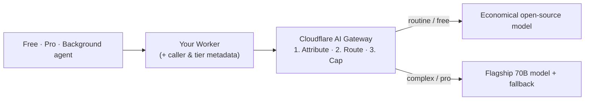

# See and control AI spend

Shipping an AI feature is fast; explaining the bill a month later is hard. When every user tier, internal team, and background job calls models through the same shared API key or binding, your invoice shows one big number and never tells you *who* spent it. Worse, your biggest spender often isn't a person at all — an automated agent stuck in a retry loop or a free tier running on a flagship model for one-line summaries can quietly burn through your budget over a weekend.

In this project course, you'll take an app you already built (or start a small new one shaped around your own use case) with three callers — two human tiers or teams and one automated background task — plus a live usage receipt on the page. Step by step, you'll put a single control point in front of your model calls so you can **see the spend first, then govern it**:

