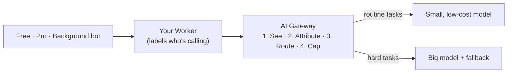

# See and control AI spend

Shipping an AI feature is fast. Explaining the bill a month later is hard. When every user tier, internal team, and background job calls models with the same key, the invoice shows one big number and never says *who* spent it. And the biggest spender often isn't a person: a bot stuck in a retry loop, or free users getting an expensive model for one-line summaries, can quietly use up a budget over a weekend.

In this project course, you'll take a small app with three callers, two kinds of human users and one background bot, and put a single checkpoint in front of its model calls: [AI Gateway](https://developers.cloudflare.com/ai-gateway/). Then you'll see the spend first, and govern it second:

You choose how technical it gets: the big picture with no code, how it works with the key settings, or hands-on with all the code. Everyone builds the same app; only the explanation changes.
