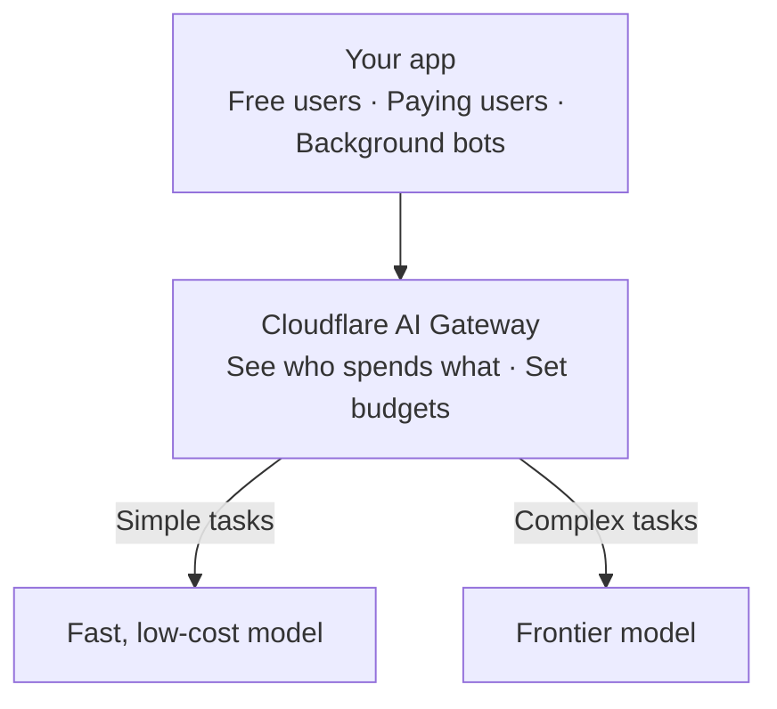

# See and control AI spend

Shipping an AI feature is fast. Explaining the bill a month later is hard. When every user tier, internal team, and background job calls models with the same key, the invoice shows one big number and never says *who* spent it. Worse, the biggest spender often isn't even a person — a background job stuck in a retry loop, or free users triggering an expensive model for one-line summaries, can burn through a month's budget over a weekend.

In this project course, you'll put [AI Gateway](https://developers.cloudflare.com/ai-gateway/) between your app and the AI models it calls, so you can see who's spending what, route each task to a model that fits, and cap background jobs before they run away:

