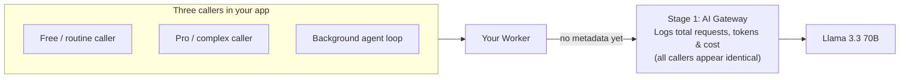

# See the blind spot

When teams first ship an AI feature, every caller in the app — free users, paying customers, internal teams, and background jobs — usually shares one model binding or API key. When the monthly bill jumps, Finance asks a simple question Engineering can't answer: *who spent it?*

And the biggest spender often isn't a person. At Cloudflare, a single internal AI code-review agent processed nearly 25 billion tokens in 30 days — running at machine speed with no cost intuition under the same shared infrastructure. Before you can set a budget or optimize models, you need a single checkpoint that sees every request.

## What you'll build

An [AI Gateway](https://developers.cloudflare.com/ai-gateway/) in front of your Worker and a live **Usage receipt** on your app's page with three callers — two human tiers or teams and one automated background loop — all calling a flagship 70B model (`@cf/meta/llama-3.3-70b-instruct-fp8-fast`). You'll fire all three and see why aggregate visibility alone still leaves every caller anonymous.

## Prerequisites

Your agent can help you with these.

- [Node.js](https://nodejs.org/) installed.
- A free [Cloudflare account](https://dash.cloudflare.com/sign-up).
- The [`cf` CLI](/courses/agent-setup/cli) logged in to your Cloudflare account (`cf auth whoami`).

## Stage 1: one checkpoint for every model call

Routing your Worker's calls through AI Gateway gives you a single pane of glass across [Workers AI](https://developers.cloudflare.com/workers-ai/), OpenAI, Anthropic, Bedrock, and other providers. Every request's model, token count, latency, and estimated cost are recorded in one place:



Passing `{ gateway: { id } }` as the third argument to `env.AI.run()` routes the call through your gateway without changing how your app works:

```ts title="src/index.ts"
const result = await env.AI.run(
  "@cf/meta/llama-3.3-70b-instruct-fp8-fast",
  { messages: [{ role: "user", content: prompt }] },
  {
    gateway: {
      id: "spend-control-gateway",
      skipCache: true,
    },
  },
);

return Response.json({
  response: (result as { response?: string }).response ?? result,
  model: "@cf/meta/llama-3.3-70b-instruct-fp8-fast",
  logId: env.AI.aiGatewayLogId,
  attributedTo: "anonymous (no metadata)",
});
```

## Why a total still isn't attribution

| What you can see after Stage 1 | What is still hidden |
| :--- | :--- |
| Total requests, input/output tokens, and estimated cost across all providers in one dashboard. | Which caller (`free`, `pro`, or `background-agent`) generated the tokens. |
| Whether the flagship 70B model is being called 4x more than yesterday. | Whether a background retry loop or free-tier traffic is eating your margin. |

In the next exercise, you'll label every request on the server so the receipt and dashboard break spend down by caller.
