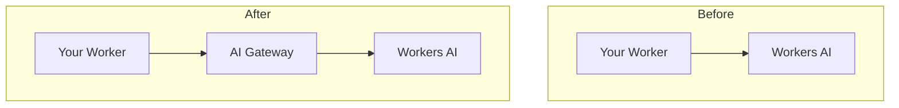

# Add AI Gateway

The starter sends requests directly to Workers AI with a hard coded model string. Workers AI provides usage reporting, but these requests don't appear in AI Gateway logs.

In this exercise, you'll create AI Gateway and connect the application to it. You'll inspect individual requests in AI Gateway logs, including the model, token usage, duration, and estimated cost.



AI Gateway now sits between your Worker and Workers AI, recording each request so you can inspect its model, usage, and estimated cost.

## Create an AI Gateway

Create a gateway using the `cf` CLI with logging enabled and caching disabled.

Create a gateway named `support-copilot` with the following command:

```sh
cf ai-gateway gateways create --id support-copilot --authentication true \
  --collect-logs true --cache-ttl 0 --cache-invalidate-on-update true \
  --rate-limiting-interval 0 --rate-limiting-limit 0 --rate-limiting-technique sliding
```

## Configure AI Gateway

When adding the configuration for AI Gateway in code, you'll need to reference it by the name you just created, `support-copilot`. Instead of hard-coding that string in the application, it's better to set it as public text variable. Do this with a text binding by adding the following line in `cloudflare.config.ts`.

```ts title="cloudflare.config.ts"
 env: {
  GATEWAY_ID: bindings.text("support-copilot"),
  //...
},
```

This allows you to reference the value `support-copilot` in your Worker as `env.GATEWAY_ID`.

As mentioned above, this project is already configured to make AI calls to Workers AI. This is configured based on the `AI` binding in `cloudflare.config.ts`.

```ts
env: {
  AI: bindings.ai({ dev: { remote: true } }),
},
```

With the binding in place, the application makes calls with `env.AI.run()`. To ensure that each of these calls runs through the new AI Gateway that you just created, you'll need to pass the AI Gateway configuration as a prop.

In `src/index.ts`, add `gateway` to the existing options object in `env.AI.run()`.

```ts title="src/index.ts"
const result = await env.AI.run(
  MODEL,
  {
    messages: [{ role: "user", content: USER_TYPES[userType].prompt }],
    max_tokens: 8,
  },
  {
    returnRawResponse: true,
    gateway: {
      id: env.GATEWAY_ID,
      collectLog: true,
      skipCache: true,
    },
  },
);
```

## View the results

Reload the running app, and click **Free user**, **Pro user**, and **Background bot** to send requests. In **Usage receipt**, **User type** still identifies the button you clicked, but **Request metadata** now shows `anonymous`. The button label comes from the app; it doesn't mean AI Gateway knows the user type.

Confirm that the successful requests appear with the expected model and status. The **Background bot** button sends 4 requests, so one click creates several entries. If you open the optional dashboard Logs page, you can also inspect:

- the model used
- the request duration
- token usage
- the estimated cost

### Viewing AI Gateway logs directly

You can check the AI Gateway logs directly by using the CF ClI:

```sh
cf ai-gateway logs list --gateway-id support-copilot --per-page 10 --order-by created_at --order-by-direction desc
```

You can additionally view the [AI Gateway logs](https://developers.cloudflare.com/ai-gateway/observability/logging/) in the Cloudflare dashboard by opening **AI** > **AI Gateway** > `support-copilot` > **Logs**.

AI Gateway now records the requests, but you still haven't attached labels identifying the callers. In the next exercise, [Add metadata to AI requests](/courses/see-and-control-ai-spend/add-metadata-to-ai-requests), you'll label requests so you can distinguish between `Free user`, `Pro user`, and `Background bot` in the logs.
