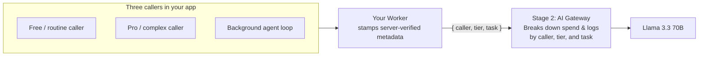

# Attribute every caller

Routing calls through AI Gateway gave you a single total, like seeing a $4,000 charge on a shared corporate credit card. To know whether that spend is healthy customer growth, free-tier users eating your product margin, or a background bot stuck in a loop, every request needs to carry a label stating who is behind it.

In one real example from Cloudflare's own AI Gateway rollout, adding attribution immediately revealed that a single employee had spent $2,000 on frontier models while the entire data science team spent $400 — and when companies ship AI to external customers, tagging by customer tier often turns a mystery "$40,000 AI bill" into "free-tier users cost us $26,000 of it."

## What you'll build

Server-attached `metadata` tags (`caller`, `tier`, and `task`) on every `env.AI.run()` call, plus a live **Spend breakdown by caller** view on your app's page. Then you'll run a mixed burst of traffic and inspect your receipt and gateway logs to uncover two hidden cost leaks.

## Prerequisites

- You've completed [See the blind spot](/courses/see-and-control-ai-spend/see-the-blind-spot) and still have that Worker and gateway.

## Stage 2: server-attached metadata tags

 AI Gateway lets your Worker attach up to five key-value pairs in `gateway.metadata`. Building on Stage 1's diagram, your Worker now stamps each request on the server before it reaches the gateway:



Attach `metadata` inside your Worker where a browser client can't spoof another user's or tier's label:

```ts title="src/index.ts"
const metadata = {
  caller: isAgent ? "agent" : "human",
  tier: isAgent ? "internal" : userTier, // "free" | "pro" | "internal"
  task: taskName,                        // "summary" | "analysis" | "auto-review"
};

const result = await env.AI.run(
  "@cf/meta/llama-3.3-70b-instruct-fp8-fast",
  { messages: [{ role: "user", content: prompt }] },
  {
    gateway: {
      id: "spend-control-gateway",
      metadata,
      skipCache: true,
    },
  },
);
```

## Two scopes, same tagging pattern

Depending on who uses your app, the same five metadata slots answer two different business questions:

| Scope | What you tag | What the breakdown reveals |
| :--- | :--- | :--- |
| **Internal people & agents** | `{ caller: "agent", team: "eng", app: "pr-review" }` | Which team or runaway background bot is driving the monthly bill. |
| **External customer-facing AI (COGS)** | `{ customerId: "acme", tier: "free", feature: "summary" }` | Cost per customer and tier so Product can see whether free users are unprofitable. |

Once you can see *who* is spending and *what* they're asking for, you'll notice everyone is still calling the flagship 70B model for every task. Next, you'll fix that in the gateway without rewriting your app.
