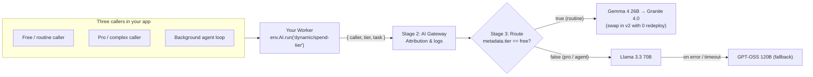

# Match models to the job

Seeing who spent what reveals the most common reason AI bills balloon: **frontier-by-default**. When a model name is hardcoded in your application, every request — whether it's a complex pro workflow or a free-tier user summarizing a one-line note — hits the same expensive model, because testing or switching models requires code changes, new provider contracts, and app redeployments.

At Cloudflare, routing secondary tasks to open-source models on [Workers AI](https://developers.cloudflare.com/workers-ai/) cut inference costs by roughly 77% compared to running everything on proprietary frontier models (saving an estimated ~$2.4M/year on a single internal security workload).

## What you'll build

A versioned [route](https://developers.cloudflare.com/ai-gateway/features/dynamic-routing/) (`dynamic/spend-tier`) in AI Gateway that inspects your `metadata.tier` tag, sends `free` / routine requests to a fast open-source model, and keeps `pro` requests on the 70B model with an automatic backup model on failure. Then you'll publish version 2 of the route to swap models with zero Worker redeploy.

## Prerequisites

- You've completed [Attribute every caller](/courses/see-and-control-ai-spend/attribute-every-caller) and still have that Worker and gateway.

## Stage 3: tier models in the gateway, not in application code

Instead of hardcoding `"@cf/meta/llama-3.3-70b-instruct-fp8-fast"` in your Worker, you call `"dynamic/spend-tier"` and let the gateway's versioned route pick the model from `metadata`:



In your Worker, the model name changes to the route name — a one-line diff:

```ts title="src/index.ts"
const result = await env.AI.run(
  "dynamic/spend-tier",
  { messages: [{ role: "user", content: prompt }] },
  {
    gateway: {
      id: "spend-control-gateway",
      metadata,
      skipCache: true,
    },
  },
);
```

## Experimenting across providers without lock-in

When your route points at third-party model providers (like OpenAI, Anthropic, Google, or Bedrock) alongside Workers AI, AI Gateway gives you two ways to handle billing:

| Approach | When to use it | How billing works |
| :--- | :--- | :--- |
| **[Unified Billing](https://developers.cloudflare.com/ai-gateway/features/unified-billing/)** | Trying models across multiple providers without signing separate vendor contracts first. | Load prepaid credits on one Cloudflare bill; provider per-token rates pass through at cost with a 5% fee on credits purchased. |
| **[Bring Your Own Keys (BYOK)](https://developers.cloudflare.com/ai-gateway/configuration/bring-your-own-keys/)** | Committing to a provider where you already have a direct enterprise contract or committed spend. | Store your provider keys centrally in AI Gateway's Secrets Store; the provider bills you directly while you keep full gateway visibility and routing. |

Your `free` and `pro` callers are now right-sized, but your background agent is still running on the 70B branch with no ceiling. In the final exercise, you'll isolate and cap it.
