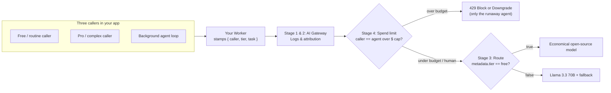

# Cap runaway loops

Visibility and model tiering lower your everyday burn rate, but they don't stop a bug. When a background agent gets stuck in a retry loop at 2:00 AM, it doesn't notice the bill climbing. And if your only safeguard is a single gateway-wide rate limit or a hard cap on your provider account, that one runaway bot takes down every paying customer using your app.

In this final exercise, you'll give your background agent its own dollar budget in [AI Gateway](https://developers.cloudflare.com/ai-gateway/features/spend-limits/) — isolating its blast radius so it blocks or downgrades to a cheap open-source model when its budget runs out, while human users keep working uninterrupted.

## What you'll build

A metadata-scoped dollar [spend limit](https://developers.cloudflare.com/ai-gateway/features/spend-limits/) (`metadata.caller == "agent"`) on your gateway and a handler in your Worker that either blocks the runaway loop with `429` or downgrades it to a lower-cost model, while proving that `pro` and `free` human requests continue to succeed.

## Prerequisites

- You've completed [Match models to the job](/courses/see-and-control-ai-spend/match-models-to-the-job) and still have that Worker, gateway, and route.

## Stage 4: the complete spend-control pipeline

Adding a metadata-scoped spend limit in front of your route completes the four-stage architecture. Every request is now logged, attributed by caller and tier, checked against per-caller dollar budgets, and routed to the right model:



A spend limit rule is defined in dollars (`"limitType": "cost"`) and scoped to any metadata key your Worker attaches:

```json title="Spend limit rule (scoped to caller = agent)"
{
  "id": "background-agent-budget",
  "enabled": true,
  "limitType": "cost",
  "limit": 50,
  "window": 2592000,
  "technique": "fixed",
  "metadata": {
    "caller": { "mode": "filter", "values": ["agent"] }
  }
}
```

## Key guardrails to keep in mind

| Question | How AI Gateway handles it |
| :--- | :--- |
| **Why dollars instead of request rate limits?** | 100 calls to a 70B or frontier model cost far more than 100 calls to an 8B model. Finance and engineering both budget in dollars. |
| **What happens when a budget is hit?** | AI Gateway returns `429 Too Many Requests` (`Spend limit exceeded`) for that rule's scope. You can stop the caller or catch `429` and fall back to a cheaper open-source model so work continues. |
| **Is the dollar cap exact to the penny on a traffic spike?** | Spend limits are **eventually consistent**: token cost is recorded as each request finishes, so a simultaneous burst near the cap can briefly overshoot before subsequent calls are blocked. |
| **Where do logs go if compliance or Finance needs multi-year BI retention?** | [AI Gateway Logpush](https://developers.cloudflare.com/ai-gateway/observability/logging/logpush/) exports full request, token, cost, and metadata logs to [Cloudflare R2](https://developers.cloudflare.com/r2/) with zero egress fees. |
